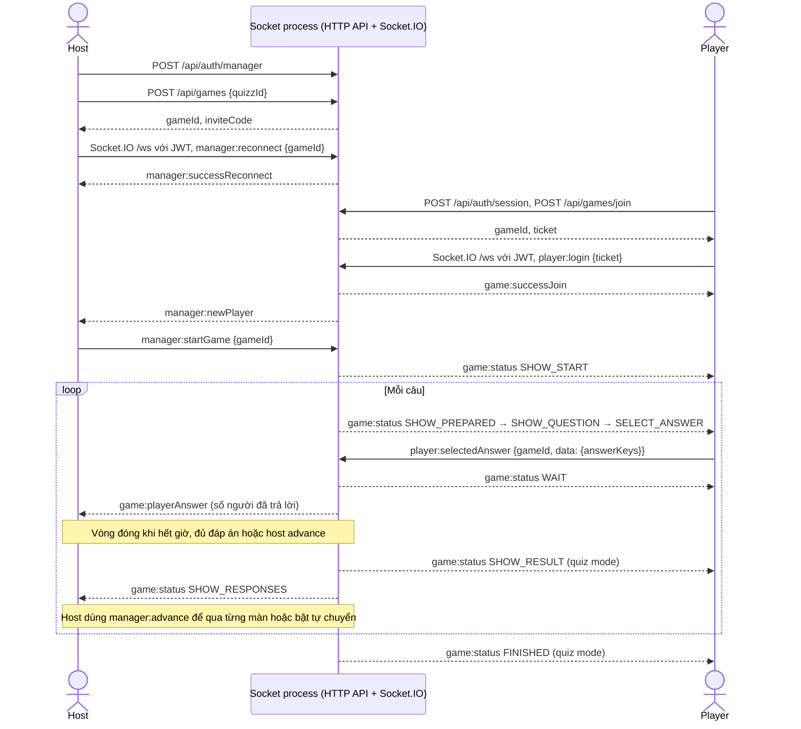

# Live Quiz · Bàn giao backend tuần 1–2

Baseline của fork là Razzia 4.0.2, commit `8345663`. Sơ đồ dưới đây mô tả luồng hiện có của baseline. Phần hợp đồng với B quy định dữ liệu cho luồng chấm điểm của dự án.

## Luồng game hiện tại



- Điểm vào HTTP ở `packages/socket/src/api/routes/games.ts`. Socket xác thực JWT ở `app.ts`, đăng ký sự kiện ở `handlers/game.ts`, tra phòng trong `Registry` rồi chuyển cho `Game`, `PlayerManager` hoặc `RoundManager` xử lý.
- `gameId` là UUID của phòng, `inviteCode` là chuỗi 6 chữ số. `clientId` trong JWT xác định người chơi qua các kết nối. `socket.id` thay đổi khi kết nối lại. Trong ván đang chạy, `player:reconnect {gameId}` trả `player:successReconnect` với điểm, trạng thái và câu hiện tại nếu `Registry` còn giữ phiên. Trước khi ván bắt đầu, người chơi bị rớt mạng phải join lại. Host dùng `manager:reconnect`.
- Baseline giữ phòng và bộ đếm giờ trong bộ nhớ, lưu quiz/kết quả vào `config/` và chấm điểm theo cơ chế của Razzia. Xem [giao thức Socket.IO](websocket-protocol.md) và [HTTP API](http-api.md) để lấy payload đầy đủ.

## Hợp đồng A ↔ B · `answer_accepted` v1

Kafka topic `answers` dùng key là `room_id` dạng chuỗi UTF-8. Ví dụ dưới đây liệt kê đầy đủ các trường trong value JSON UTF-8 của phiên bản này.

```json
{
  "event_id": "a59b2cc8-3135-41cd-a21e-44d7e3abfb59",
  "room_id": "0193bd11-a101-7d4e-a0a3-13e72a53cf48",
  "round_id": "0193bd11-a102-7e4e-a0a3-13e72a53cf48",
  "player_id": "0193bd11-a103-7f4e-a0a3-13e72a53cf48",
  "choice": 1,
  "is_correct": true,
  "accepted_at": "2026-11-05T09:45:00.123Z"
}
```

- Bốn ID là UUID dạng chuỗi. `room_id` tương ứng `gameId`. `player_id` lấy từ JWT `clientId` đã xác thực, trong phạm vi phòng. `round_id` xác định lượt mở câu hỏi. `event_id` giữ nguyên khi publisher gửi lại.
- `choice` là chỉ số đáp án bắt đầu từ 0 của MVP trắc nghiệm một đáp án. Gateway xác thực lựa chọn theo snapshot của vòng và xác định `is_correct`. `accepted_at` là giờ máy chủ ghi nhận đáp án, biểu diễn ISO 8601 UTC trong JSON.
- A ghi `answers` và `outbox` trong cùng transaction cho lần gửi hợp lệ đầu tiên. Gateway dùng khóa `FOR SHARE` trên dòng vòng chơi khi kiểm tra `status` và `closes_at` để đồng bộ với thao tác đóng vòng. So thời hạn với thời điểm chấp nhận lấy từ DB sau khi đã giữ khóa. `closes_at = NULL` nghĩa là vòng không giới hạn giờ. Chỉ xác nhận sau khi commit thành công.
- B đọc các hàng chưa publish, ghép dữ liệu đáp án bằng truy vấn dưới đây, gửi Kafka với `acks=all`, rồi cập nhật `published_at` cho đúng `event_id` sau khi broker xác nhận. Giá trị event đến từ hàng đáp án đã chấp nhận và hàng outbox tham chiếu nó. Trình xử lý nên chấp nhận việc giao lại event nếu publisher dừng giữa lúc gửi Kafka và commit.

```sql
SELECT o.event_id, a.room_id, a.round_id, a.player_id,
       a.choice, a.is_correct, a.accepted_at
FROM outbox AS o
JOIN answers AS a USING (round_id, player_id)
WHERE o.published_at IS NULL
ORDER BY o.created_at, o.event_id
LIMIT 100
FOR UPDATE OF o SKIP LOCKED;
```

- Score worker ghi `event_id` vào `processed_answer_events` bằng `ON CONFLICT DO NOTHING`. Chỉ cập nhật `results` khi chèn được ID mới, trong cùng transaction. Cộng 1 cho đáp án đúng, 0 cho đáp án sai. Leaderboard lấy từ `players` kết hợp `results`, mặc định 0 điểm và tính đồng hạng bằng `RANK() OVER (ORDER BY points DESC)` theo từng phòng.

## Migration PostgreSQL

Chạy lệnh dưới đây một lần trên database dành cho dự án bằng tài khoản migration, trước khi các service bắt đầu dùng schema.

```sh
psql "$DATABASE_URL" -v ON_ERROR_STOP=1 -f packages/socket/migrations/001_live_quiz.sql
```

- `quizzes.id` là `text` để giữ ID của file Razzia hiện có. `questions.definition` và `rounds.question_snapshot` lưu đối tượng câu hỏi theo [định dạng quiz Razzia](quiz.md). Vị trí câu/vòng bắt đầu từ 1. Snapshot giữ nguyên lựa chọn và lời giải của ván khi quiz gốc được sửa hoặc xóa. Payload gửi người chơi khi mở vòng phải bỏ thông tin lời giải.
- `rooms` tái sử dụng được mã mời khi phòng đã kết thúc hoặc hủy. Mỗi phòng chỉ có một vòng mở. Khoá ngoại ghép ngăn đáp án tham chiếu người chơi hoặc vòng của phòng khác. Một cặp `(round_id, player_id)` chỉ có một đáp án và một hàng outbox tương ứng.
- Migration khởi tạo schema. Việc chuyển dữ liệu và kết nối luồng game với DB bắt đầu từ tuần 3.

## Hợp đồng A ↔ C · Hai tiến trình triển khai độc lập

```sh
docker build --target web -t razzia-web:week2 .
docker build --target socket -t razzia-socket:week2 .
```

| Service  | Cổng container | Đường dẫn Ingress cùng hostname                                    | Health check                            |
| -------- | -------------- | ------------------------------------------------------------------ | --------------------------------------- |
| `web`    | `3000`         | `/` (`Prefix`, gồm `/branding/` và `/media/`)                      | `GET /`                                 |
| `socket` | `3001`         | `/api` và `/ws` (`Prefix`, giữ nguyên path, bật WebSocket upgrade) | `GET /health/live`, `GET /health/ready` |

- ALB health check của target `socket` dùng `/health/ready`. Hai probe socket của tuần 2 kiểm tra tiến trình đã khởi động và phục vụ HTTP. Đường dẫn `/api/health` vẫn dùng được cho baseline và test hiện có. `/metrics` được lên lịch ở tuần 5.
- `socket` nhận `SOCKET_PORT=3001`, `CONFIG_PATH=/app/config`, `MANAGER_PASSWORD` và `JWT_SECRET` từ cấu hình triển khai. Trên AWS, đặt `MANAGER_PASSWORD` và `JWT_SECRET` trong Secret, với `JWT_SECRET` tối thiểu 32 ký tự và cùng giá trị giữa các socket pod. `web` dùng cổng `3000` trong image và gọi `/api`, `/ws` cùng origin.
- Từ tuần 3, socket dùng `DATABASE_URL` và `REDIS_URL` từ Secret để kết nối PostgreSQL và Redis. Cấu hình WebSocket-only đi cùng Redis adapter ở tuần 3.
- Tuần 2 chạy **một socket replica** vì phòng vẫn ở `Registry` của process. Để dùng upload media hoặc branding dạng file với hai container, mount cùng thư mục cấu hình vào `/app/config`, socket ghi được và web chỉ đọc. Trên các node khác nhau cần một volume dùng chung nếu dùng các file này. Quiz và kết quả của baseline được đọc/ghi ở socket process.
- Luồng local sẵn có chạy qua hai terminal với `pnpm dev:web` và `pnpm dev:socket`. Vite proxy `/api` và `/ws` đến socket nên trình duyệt chỉ cần mở cổng `3000`. Lệnh `docker build .` mặc định vẫn tạo image baseline gộp web và socket.
